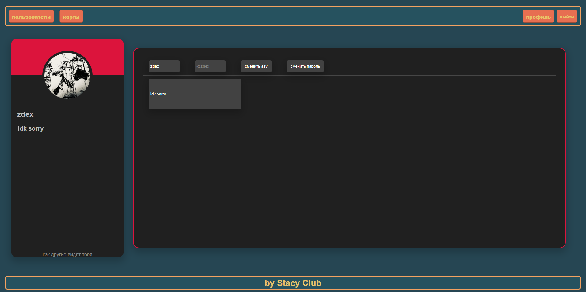
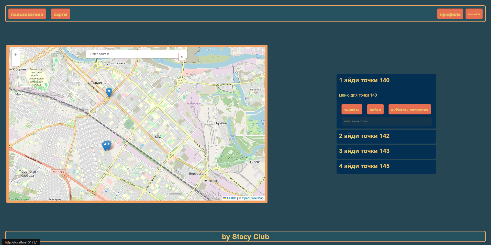

# Интерактивная карта с пользовательскими точками

веб-приложение для создания, управления и шеринга геолокационных меток

> **Проект находится в разработке**

## Скриншоты

| Профиль | Карта |
|---------|-------|
|  |  |

## Стек технологий

- **Frontend:** React, TypeScript, Leaflet, React Router
- **Backend:** Node.js, Express, JWT, bcrypt
- **База данных:** PostgreSQL
- **Инструменты:** Multer (загрузка файлов), Vite

## Реализовано

### Авторизация
- Регистрация и вход пользователей через JWT
- Пароли хешируются с помощью bcrypt, вход реализован через `bcrypt.compare()`
- Время жизни токена: 1 час (проверяется и на фронтенде, и на бэкенде)

### Карта
- Добавление точек через кастомное контекстное меню
- Поиск локаций через геокодинг (OpenStreetMap)
- Сохранение позиции карты (zoom, center) в localStorage

### Профиль
- Изменение имени, пароля, описания и аватара
- Локальное хранение аватара с автоматическим удалением предыдущего

## Запуск локально

### Backend

1. Перейдите в папку `backend`
2. Создайте файл `.env` по образцу `.env.example`
3. Создайте базу данных по файлу `schema.sql`
4. Установите зависимости: `npm install`
5. Запустите сервер: `npm run dev`

### Frontend

1. Перейдите в папку `frontend`
2. Укажите URL своего бэкенда в файле `config.ts`
3. Установите зависимости: `npm install`
4. Запустите приложение: `npm run dev`

## Roadmap

### Ближайшие планы
- [ ] Система друзей
- [ ] Система шеринга точек
- [ ] Работа над визуальной частью
- [ ] Светлая и тёмная темы

### Возможно позже
- [ ] Облачное хранение аватаров
- [ ] Перемещение точек перетаскиванием
- [ ] Тесты